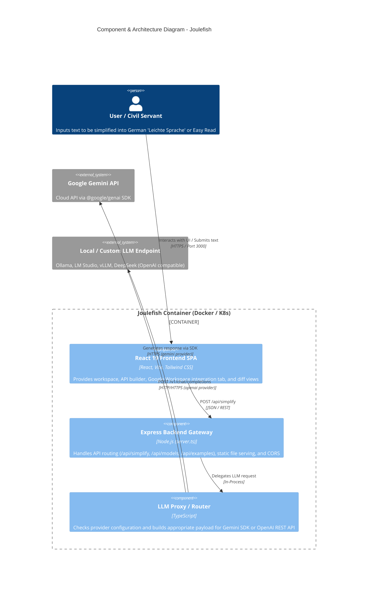
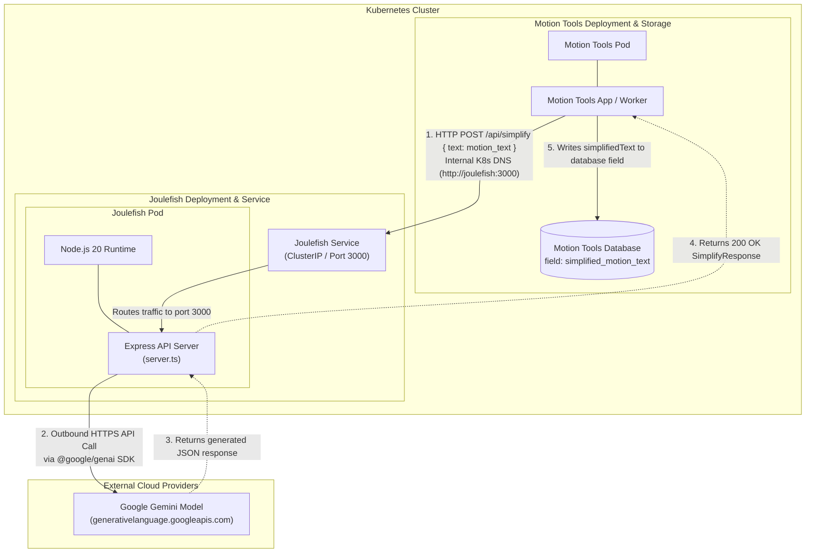
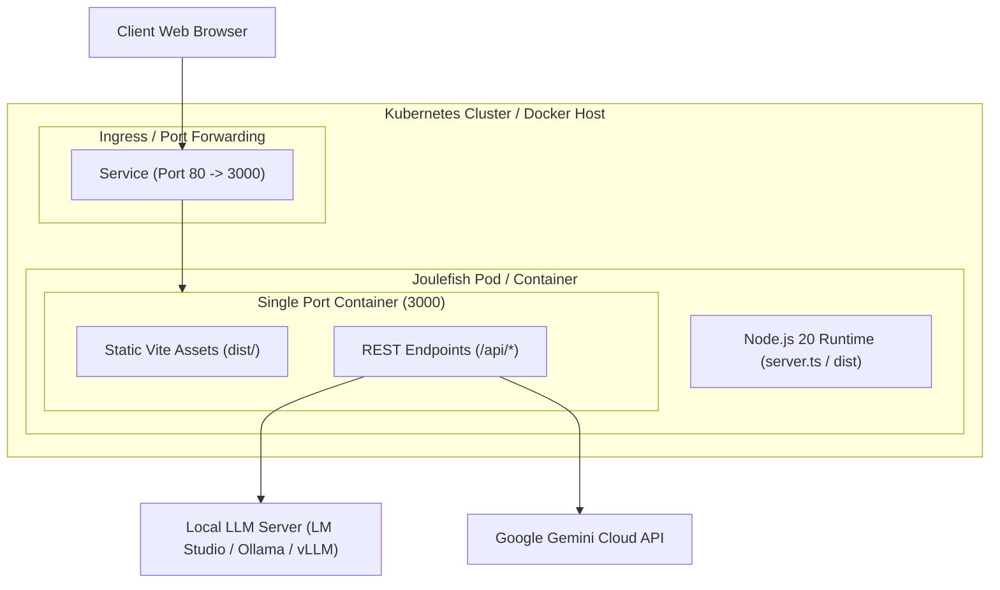
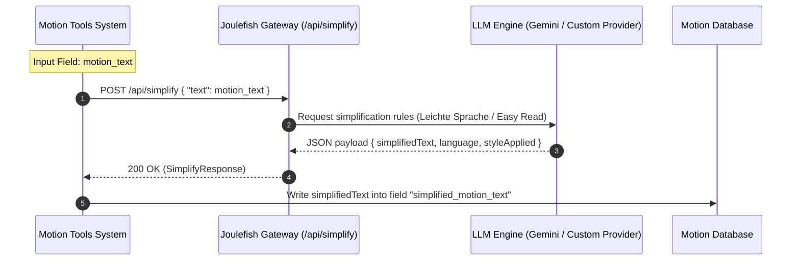
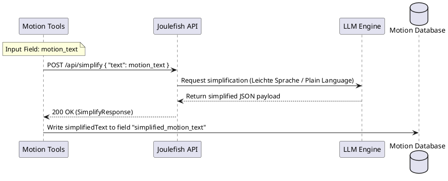
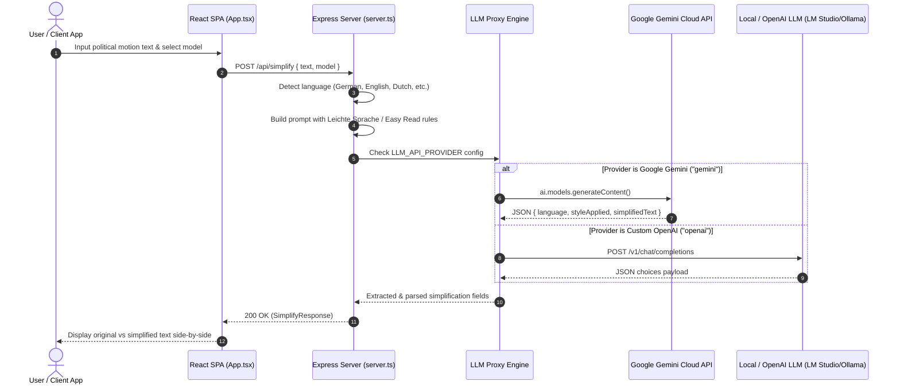
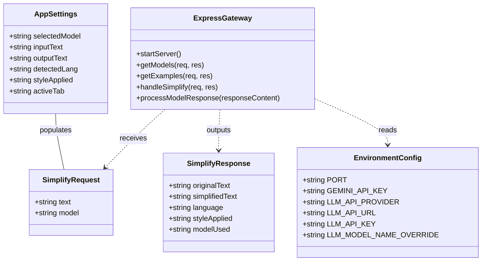

# 🐟 Joulefish Architecture & Flows Overview

This directory contains the architecture specifications, deployment topographies, sequence flows, and class definitions for **Joulefish**—a cloud-native microservice for translating complex political motions into accessible language (*Leichte Sprache* / Easy Read / *Eenvoudig Communiceren*).

---

## 📑 Table of Contents

- [1. Component & System Context Architecture](#1-component--system-context-architecture)
- [2. Kubernetes Deployment Flow (Motion Tools to Joulefish)](#2-kubernetes-deployment-flow-motion-tools-to-joulefish)
- [3. General Infrastructure & Container Deployment](#3-general-infrastructure--container-deployment)
- [4. Motion Tools Integration Sequence Flow](#4-motion-tools-integration-sequence-flow)
- [5. Full Application Sequence Flow](#5-full-application-sequence-flow)
- [6. Data Models & API Gateway Class Diagram](#6-data-models--api-gateway-class-diagram)
- [7. Generating SVG Assets](#7-generating-svg-assets)

---

## 1. Component & System Context Architecture

The **C4 Component Diagram** illustrates the high-level architecture of Joulefish. The application bundles a React 19 Single Page Application (SPA) frontend and an Express 4 Node.js API Gateway into a single container. The backend LLM router handles dynamic request translation and routes requests to either cloud API endpoints (Google Gemini API via `@google/genai` SDK) or local/private OpenAI-compatible endpoints (LM Studio, Ollama, vLLM, DeepSeek).



---

## 2. Kubernetes Deployment Flow (Motion Tools to Joulefish)

This diagram highlights the internal Kubernetes inter-pod communication flow when **Motion Tools** integrates with Joulefish as a backend microservice:

1. **Motion Tools Pod** extracts the motion text field `motion_text` and issues an internal HTTP `POST /api/simplify` call to the Joulefish `ClusterIP` Service (`http://joulefish:3000`).
2. **Joulefish Pod** processes the incoming request and performs an outbound HTTPS API call to the **Google Gemini Cloud API**.
3. **Google Gemini** returns the simplified JSON payload back to Joulefish.
4. **Joulefish** returns a `200 OK` `SimplifyResponse` back to Motion Tools.
5. **Motion Tools** writes the resulting `simplifiedText` into its database field `simplified_motion_text`.



---

## 3. General Infrastructure & Container Deployment

The infrastructure diagram demonstrates the single-port architecture of the Joulefish container. The Express gateway hosts both the compiled Vite static SPA assets and the backend `/api/*` REST endpoints on port 3000 behind a Kubernetes Service or Docker Ingress layer.



---

## 4. Motion Tools Integration Sequence Flow

Below are the sequence flows specifically modeling Motion Tools calling the Joulefish API with `{ "text": motion_text }` and persisting the output into `simplified_motion_text`.

### Mermaid Sequence Diagram (`motionToolsSequenceDiagram.mmd`)



### PlantUML Sequence Diagram (`diagram.uml`)



---

## 5. Full Application Sequence Flow

This sequence diagram depicts the detailed request lifecycle executed inside `server.ts` when processing simplification requests:

1. Automatic input language detection (German, English, Dutch, etc.).
2. Construction of system instructions (e.g. DIN SPEC 33429 for German *Leichte Sprache*).
3. LLM provider selection based on environment configuration (`LLM_API_PROVIDER`).
4. Robust JSON parsing and fallback cleanup of LLM output.
5. Returning structured JSON (`originalText`, `simplifiedText`, `language`, `styleApplied`, `modelUsed`).



---

## 6. Data Models & API Gateway Class Diagram

The class diagram maps the data interfaces defined in `src/types.ts`, backend endpoints, and environmental variables configured in `server.ts`.



---

## 7. Generating SVG Assets

You can automatically compile all `.mmd` diagrams in this folder into vector SVG images by executing `export_mmd.sh`:

```bash
cd architecture
bash export_mmd.sh
```

This uses `@mermaid-js/mermaid-cli` (`mmdc`) to generate SVG files (`classDiagram.svg`, `componentAndArchiteture.svg`, `deploymentAndInfrastructure.svg`, `kubernetes.svg`, `motionToolsSequenceDiagram.svg`, `sequenceDiagram.svg`).
